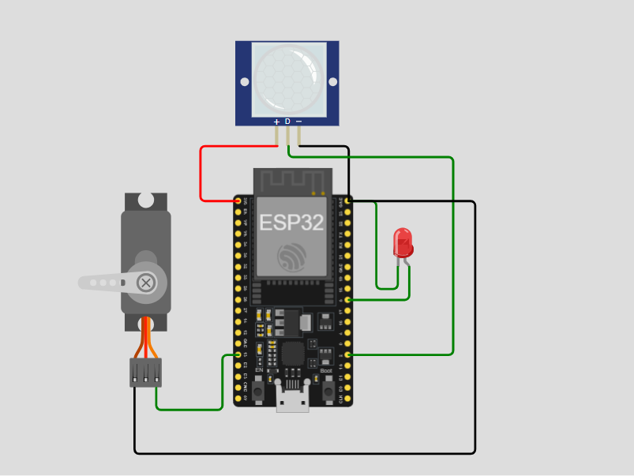
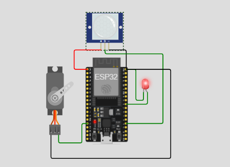

# Comedero Inteligente para Gatos
Proyecto del curso EL-1200 Introducción a la Electrónica, TEC, II semestre 2026.

**Integrantes:** Mariángel Jimena Guerrero Matarrita

## Descripción
Comedero automático que dispensa alimento solo cuando detecta al gato
y evita servir de más si el gato se queda frente al plato.

## Funcionamiento
El sensor PIR detecta la presencia del gato.
El servomotor abre la compuerta 1,5 s y la vuelve a cerrar.
El LED indica que se está sirviendo.
Una variable booleana (dispensado) evita que se sirva otra vez
mientras el gato sigue ahí.

## Conexiones
| Componente | Pin del ESP32 |
| --- | --- |
| Sensor PIR | GPIO 2 |
| Servomotor | GPIO 13 |
| LED (con 220 Ω) | GPIO 5 |
| Alimentación | 3V3 y GND |

## Simulación
Proyecto en Wokwi: <enlace público>

## Código
Ver la carpeta firmware/. Biblioteca usada: ESP32Servo.

## Evidencia

## Mejoras futuras
- Programar horarios de alimentación y ajustar la cantidad de porción según el tiempo o ángulo del servomotor.
- Agregar un sensor de nivel para detectar cuando queda poco alimento y enviar avisos por Wi-Fi usando el ESP32.
